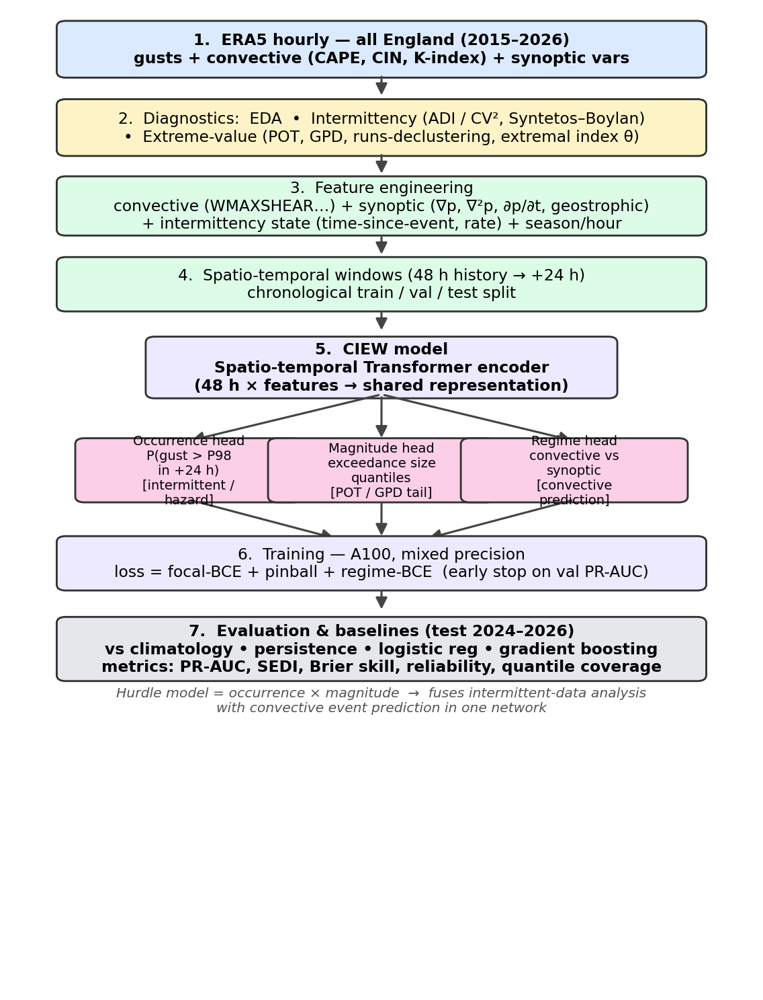
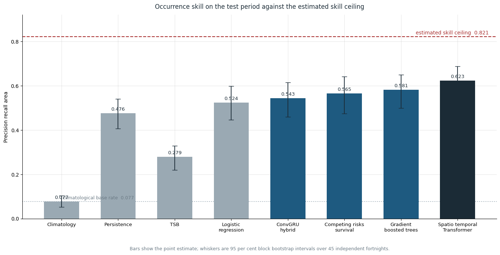
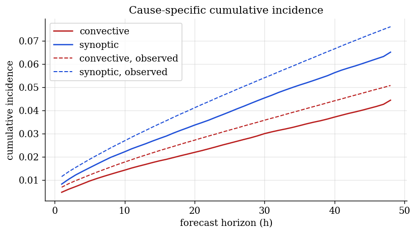

# Forecasting extreme wind gusts over England

Code for my MSc Artificial Intelligence dissertation at Brunel University London (2026):
**Convection-informed and survival-based forecasting of extreme wind gusts over England,
from intermittent data analysis to a competing-risks deep hazard model on ERA5.**

Extreme gusts are rare, arrive in bursts and are heavy-tailed, so they sit where extreme
value statistics meet intermittent-demand forecasting. This project forecasts, 24 hours
ahead and from the atmospheric state alone, whether a cell will see an extreme gust
(above its local 98th percentile), when the next one arrives, what drives it (convective
downburst or Atlantic depression) and how large it is. It also measures how much skill
the state permits at all, using a perfect-prognosis ceiling.



## Results

11.5 years of hourly ERA5 reanalysis (2015–2026) over 520 land cells covering England.
Chronological train/validation/test split, paired block bootstrap for every comparison.

| Model | Occurrence PR-AUC | Notes |
|---|---:|---|
| Climatology | 0.077 | base rate |
| Gradient-boosted trees (LightGBM) | 0.581 | best magnitude skill: 9.5% CRPS skill |
| Competing-risks survival network | 0.570 | not separable from the trees; adds hazard curves, 31.5% integrated Brier skill |
| **Spatio-temporal Transformer (MAE-pretrained)** | **0.623** | best on occurrence; the margin over trees, survival and hybrid is resolved by the bootstrap |
| Perfect-prognosis ceiling | 0.821 | empirical upper bound at 24 h lead |

The best forecast reaches about 76% of the measured ceiling. Storm-type attribution
(0.660 vs 0.631 for a logistic baseline) is reported honestly as not yet resolved.

<p>
  
  
</p>

## Notebooks

Each notebook runs end to end on Google Colab (one A100), mounting Drive when present.

| Notebook | What it does |
|---|---|
| [`01_gradient_boosted_trees`](notebooks/01_gradient_boosted_trees.ipynb) | ERA5 loading, intermittency analysis (Syntetos–Boylan ADI/CV², GPD tail fits, declustering), feature engineering (convective CAPE/CIN/WMAXSHEAR, synoptic MSLP gradients, geostrophic wind, gust advection, 5×5 neighbourhood context) and the LightGBM hurdle model |
| [`02_linear_hazard_convgru`](notebooks/02_linear_hazard_convgru.ipynb) | Interpretable linear hazard with a ConvGRU spatial correction |
| [`03_competing_risks_survival`](notebooks/03_competing_risks_survival.ipynb) | Discrete-time competing-risks survival network (ConvGRU encoder): convective vs synoptic hazards, lead-time skill sweep, cumulative incidence by cause, and the perfect-prognosis predictability ceiling |
| [`03b_survival_severity_head_refit`](notebooks/03b_survival_severity_head_refit.ipynb) | Severity (magnitude quantile) head refit with conformal intervals |
| [`04_spatiotemporal_transformer`](notebooks/04_spatiotemporal_transformer.ipynb) | Space–time Transformer (8.9M params) pretrained as a masked autoencoder, then fine-tuned multi-task |
| [`05_revision_analyses`](notebooks/05_revision_analyses.ipynb) | Reproduction gates for every reported table row, intermittent-demand and logistic baselines, backtest, seasonal analysis and the paired severity bootstrap |
| [`06_block_bootstrap`](notebooks/06_block_bootstrap.ipynb) | Paired moving-block bootstrap for every model comparison |

## Data

ERA5 hourly single levels from the [Copernicus Climate Data Store](https://cds.climate.copernicus.eu/)
(15 variables, Jan 2015 – Jun 2026, about 2.2 GB). Not included in the repo. To fetch it:

```bash
pip install cdsapi xarray netCDF4 pandas numpy
# put your CDS key in ~/.cdsapirc first
python scripts/download_england_full.py     # -> data/era5_england_raw_full/
```

The notebooks look for `era5_england_raw_full/` under `./data`, `../data` or your Drive.
`scripts/download_plains_era5.py` and `cds_plains.py` fetch a US Great Plains domain
for the transfer experiment, paired with NOAA Storm Events damage labels.

## Stack

Python · PyTorch · LightGBM · xarray · pandas · scikit-learn · SHAP · Google Colab (A100)

## Author

Mehdy Chakyb ABDI · supervised by Dr Weibo Liu, Department of Computer Science, Brunel University London
